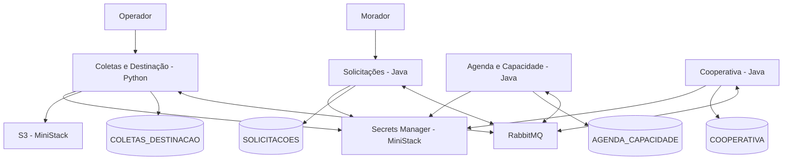

# Coleta de resíduos eletrônicos — Sistemas Distribuídos

Trabalho acadêmico FURB. Quatro serviços, Java 21/Spring Boot e Python/FastAPI. A redução para duas linguagens foi informada pelo grupo. Oracle substitui o PostgreSQL/RDS do planejamento; quatro usuários/schemas isolam os dados logicamente, em uma instância compartilhada.

## Arquitetura



RabbitMQ desacopla produtores e consumidores, permite filas independentes, confirmação, retry e DLQ. S3 guarda arquivos fora do banco; Secrets Manager centraliza credenciais recuperadas na inicialização. Oracle oferece transações e atualização atômica de capacidade. Não há transações distribuídas XA: a Saga usa compensações e consistência eventual. Inbox e Outbox são persistidas localmente; entrega pode ocorrer mais de uma vez. Consumidores concorrentes não garantem ordenação global.

## Inicialização

Pré-requisitos: Docker com Compose v2, portas 1522, 5672, 15672, 4566, 8081, 8082 e 8084 disponíveis; acesso às imagens e dependências de build. Execute na raiz. Para ambiente novo, copie `.env.example` para `.env` e altere as senhas (letras, números e underscore para schemas Oracle). Em ambiente existente preserve o `.env` e o nome do projeto Compose: trocar senhas no arquivo não altera automaticamente usuários Oracle existentes.

```powershell
# Apenas ambiente novo:
Copy-Item .env.example .env
# Edite .env antes de subir.
docker compose up -d --build --scale cooperativa=3
docker compose ps
docker compose logs --tail=100 ministack-init
```

O init cria bucket e segredos, e o Oracle cria usuários; migrações criam tabelas. Aguarde os endpoints `/actuator/health` em 8081, 8082, 8084; para Cooperativa consulte `docker compose port cooperativa 8080 --index 1`. RabbitMQ Management: http://localhost:15672 (credenciais do .env). Se o emulador perder recursos, execute `docker compose up --no-deps --force-recreate ministack-init` e depois `docker compose up -d --no-deps --scale cooperativa=3 solicitacoes agenda cooperativa coletas`. Isso não recupera arquivos S3 perdidos. Nunca use `down -v` em ambiente com dados a preservar.

## Fluxo e API

```powershell
$bairro = 'Demo-' + [guid]::NewGuid().ToString().Substring(0,8)
$data = (Get-Date).AddDays(7).ToString('yyyy-MM-dd')
Invoke-RestMethod -Method Post -Uri http://localhost:8082/agenda/capacidade -ContentType application/json -Body (@{bairro=$bairro;dataColeta=$data;capacidadeTotal=10}|ConvertTo-Json)
$s = Invoke-RestMethod -Method Post -Uri http://localhost:8081/solicitacoes -ContentType application/json -Body (@{bairro=$bairro;dataColeta=$data}|ConvertTo-Json)
Invoke-RestMethod -Uri "http://localhost:8081/solicitacoes/$($s.id)"
```

Repita GET até CONFIRMADA ou CANCELADA. POST responde 202. ColetaConfirmada vai a duas filas independentes, efetivando a reserva e criando a coleta. Em http://localhost:8084/api/coletas consulte a coleta pelo solicitacaoId (listagem paginada); use seu id nas rotas:

| Método | Rota relativa a /api/coletas/{id} | Corpo |
|---|---|---|
| POST | /execucao | responsavel, observacao |
| POST | /triagem | pesoKg, classificacao |
| POST | /comprovantes | multipart campo arquivo (PDF/PNG/JPEG, até 10 MiB) |
| POST | /destinacao | destino, metodo, comprovanteId |
| GET | /comprovantes | — |
| GET | /comprovantes/{cid} | — |

## Demonstração F1–F8

Use bairros únicos e registre IDs, logs, estados e filas. Taxas são frações de 0 a 1. Para mudar simulação, configure variáveis no PowerShell e recrie somente Cooperativa (`docker compose up -d --no-deps --force-recreate --scale cooperativa=3 cooperativa`).

| Cenário | Procedimento | Evidência esperada |
|---|---|---|
| F1 | TAXA_FALHA=1, TAXA_RECUSA=0 (prefixo COOPERATIVA_) | Exceções, expiração da Saga, vaga liberada, cancelamento consultável |
| F2 | Interromper réplica durante processamento | Reentrega e efeito único; para janela pós-commit/pré-ACK use instrumentação temporária, não código de produção |
| F3 | Republicar envelope original cinco vezes, mesmo messageId | Inbox única e efeito único |
| F4 | Publicar payload inválido na rota correta | Retry e DLQ; mensagem válida seguinte processada |
| F5 | 100 POST concorrentes para capacidade 10, sem falha/recusa | 10 confirmadas, 90 canceladas, nenhuma reserva extra |
| F6 | docker compose stop rabbitmq; enviar solicitação; aguardar 30 s; docker compose start rabbitmq | Reconexão sem reiniciar apps, outbox drenada |
| F7 | LATENCIA_MIN_MS=LATENCIA_MAX_MS=120000, prazo 60 s | Cancelamento e liberação; se aceite tardio não for emitido naturalmente, injetar envelope válido e declarar que é sintético |
| F8 | Três réplicas de cooperativa, várias solicitações | Distribuição nos logs e efeito único |

Restaurar taxas a 0 e latência 100–2000 ms após os testes. Inspecionar filas: `docker compose exec -T rabbitmq rabbitmqctl list_queues name messages_ready messages_unacknowledged consumers`. Contratos em `contracts/events/v1`; envelope comum messageId, correlationId, type, version, occurredAt, payload. Java valida campos manualmente; Python usa JSON Schema. Testes locais: `python -m pip install pytest jsonschema` e `PYTHONPATH=coletasedestinacao python -m pytest tests coletasedestinacao/tests` (em PowerShell, definir `$env:PYTHONPATH='coletasedestinacao'` antes). Testes Java e integração requerem ambiente Maven/Docker.

## Entrega e limitações

Não publique `.env`, credenciais ou arquivos da IDE. A revisão não adiciona bônus de OpenTelemetry, CQRS, IaC, autoescala ou coexistência de versões. Consulte `REVISAO_FINAL.md` para alterações e testes ainda necessários.
